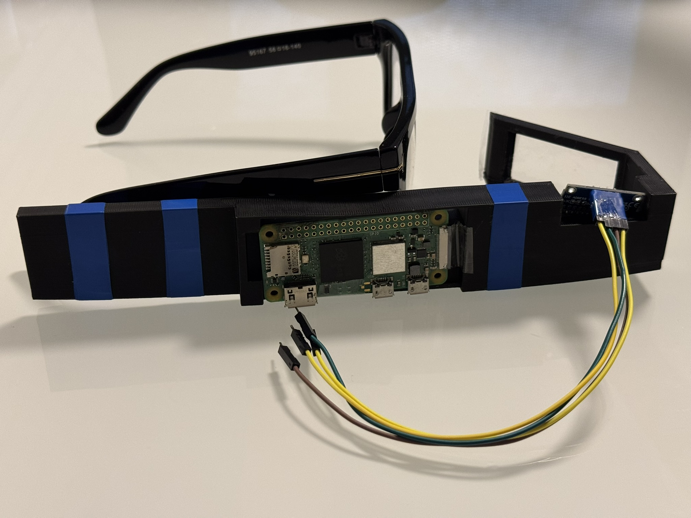
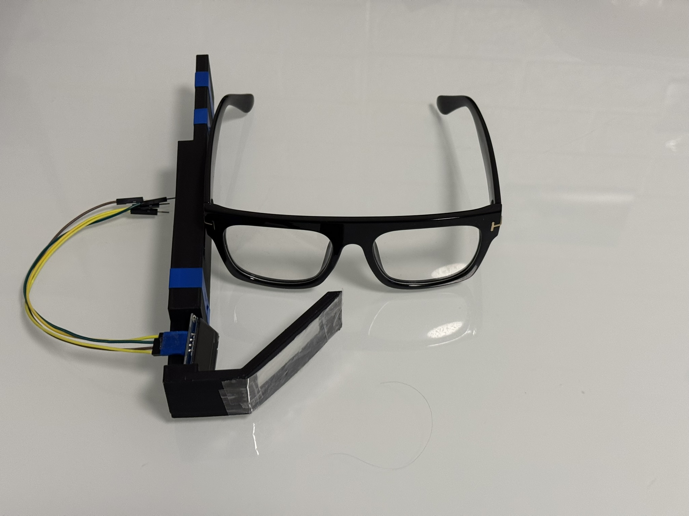
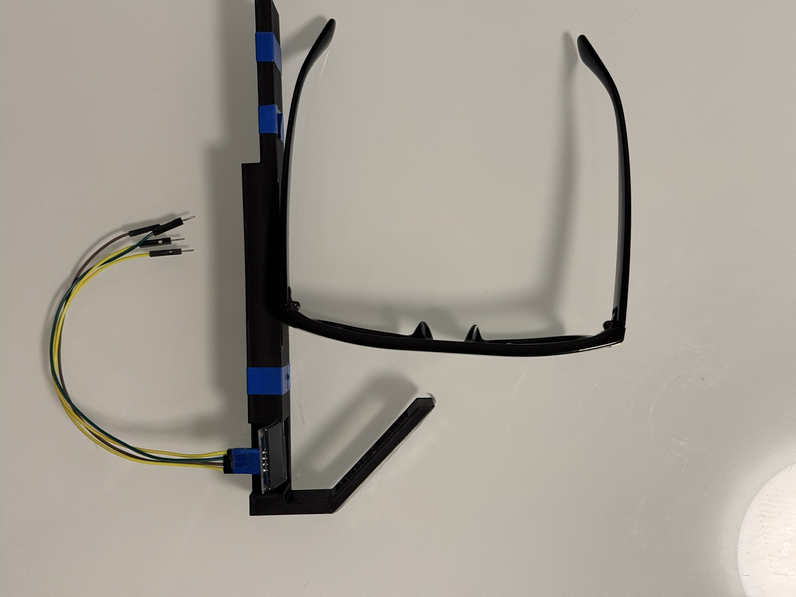
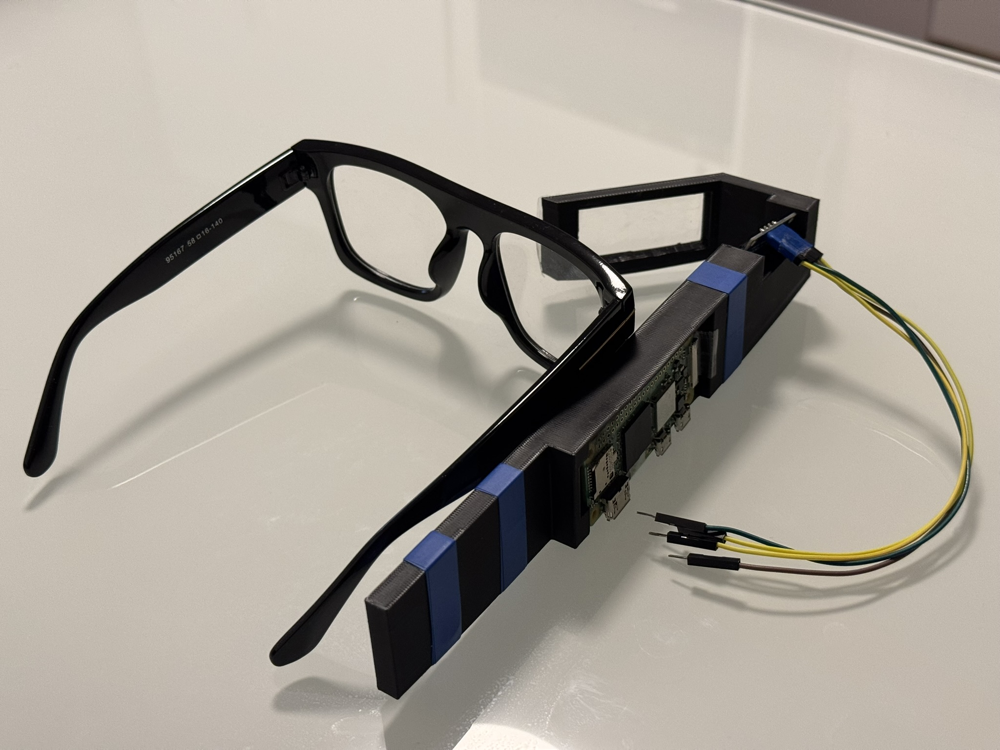
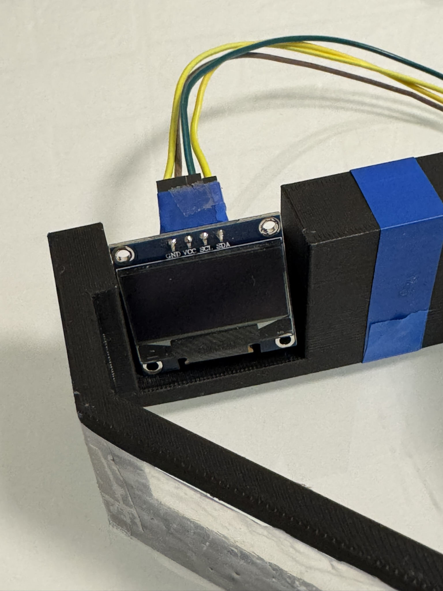
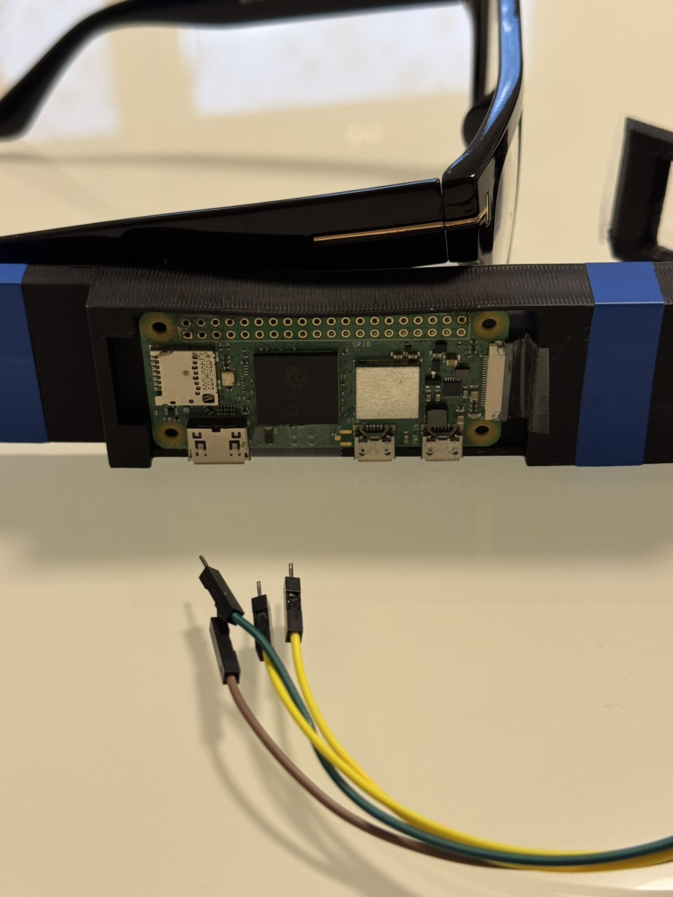

# AR-Brille

Für ein Schulprojekt habe ich eine eigene AR-Brille mit 3D-gedruckter Halterung gebaut. Ein Raspberry Pi steuert das kleine Display an; die Menüs habe ich selbst gepixelt.

## Funktionsweise

Die Software spiegelt die Menüs vor der Anzeige. Eine transparente Folie reflektiert das Displaybild ins Auge. Gleichzeitig schaut man durch Brille und Folie auf die Umgebung – so überlagern sich Menü und reale Sicht.

## Aufbau

Raspberry Pi und Halterung · Display und Folie

Weitere Ansichten und Details

Vorderansicht und Draufsicht

Seitlicher Aufbau und Display

Raspberry Pi im Detail

