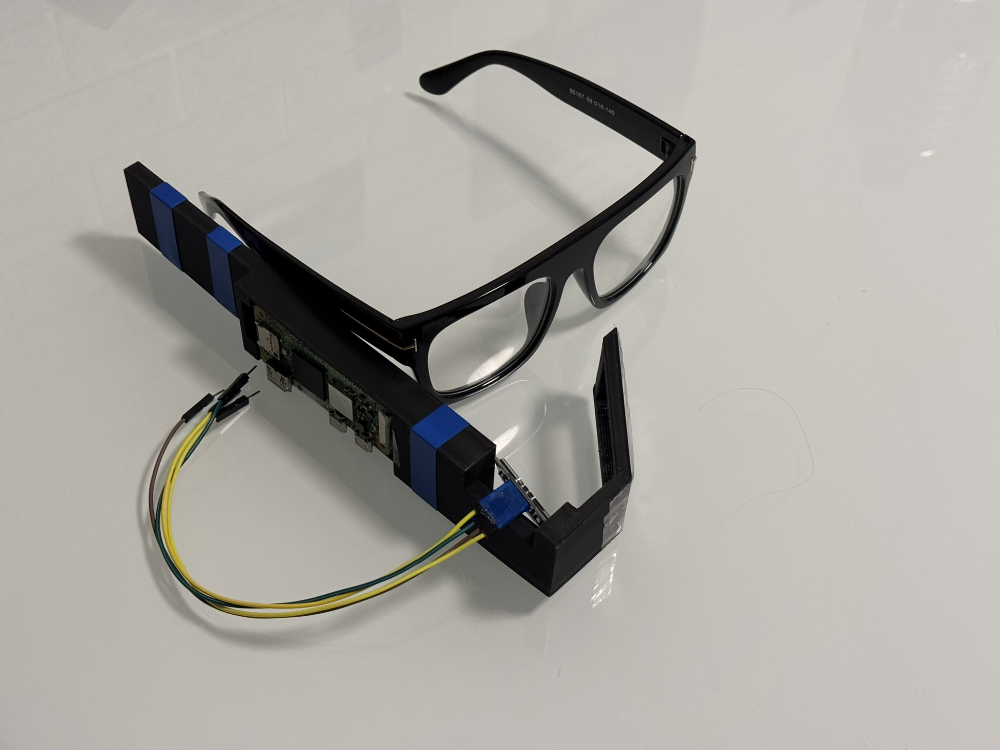
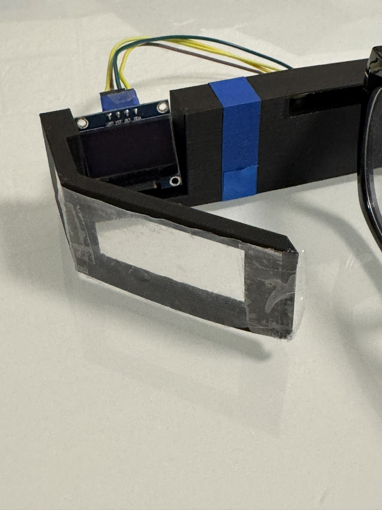

# AR-Brille

Für ein Schulprojekt habe ich eine eigene AR-Brille entworfen und gebaut. Sie blendet eine kleine Anzeige ins Sichtfeld ein, während die Umgebung sichtbar bleibt.

Ein Raspberry Pi steuert das kleine Display an und führt die Software aus. Die Menüs für die Anzeige habe ich selbst gepixelt.

Eine 3D-gedruckte Halterung verbindet die Bauteile mit der Brille. Das Displaybild wird über eine transparente, leicht reflektierende Folie ins Sichtfeld eingeblendet.

## Aufbau

1. Der Raspberry Pi übernimmt die Berechnungen und steuert das Display an.
2. Die Halterung hält den Computer und das Display an der Brille in Position.
3. Eine transparente Folie sitzt vor dem Brillenglas und dient als reflektierende Fläche.

## So gelangt das Bild ins Sichtfeld

1. Die Software spiegelt die Menüs vor der Ausgabe, damit sie später richtig herum erscheinen.
2. Das Display zeigt die Menüs an; die Folie reflektiert das Bild in Richtung Auge.
3. Durch Brillenglas und Folie bleibt gleichzeitig die Umgebung sichtbar, sodass sich Anzeige und reale Sicht überlagern.

